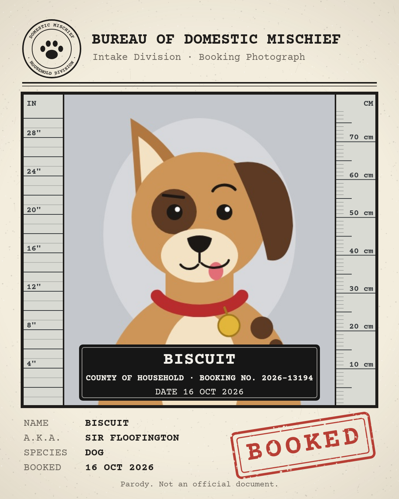
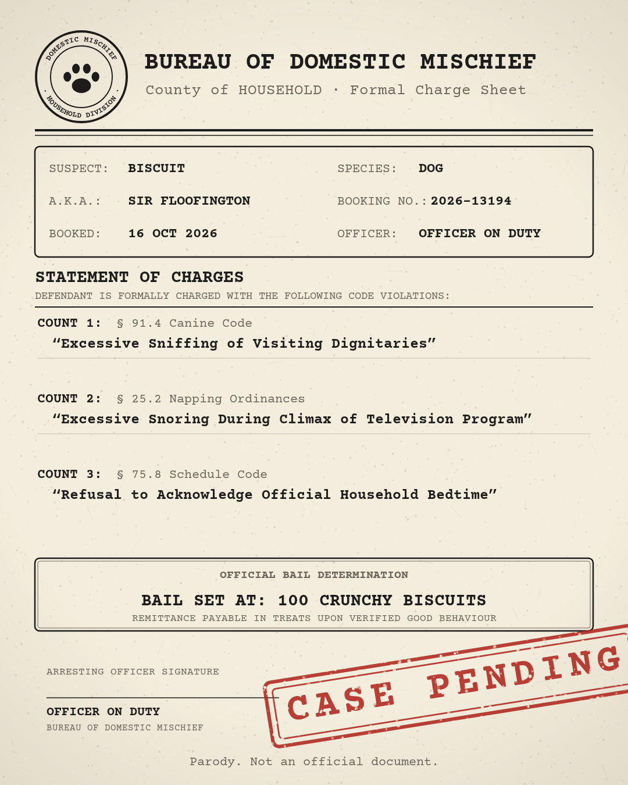
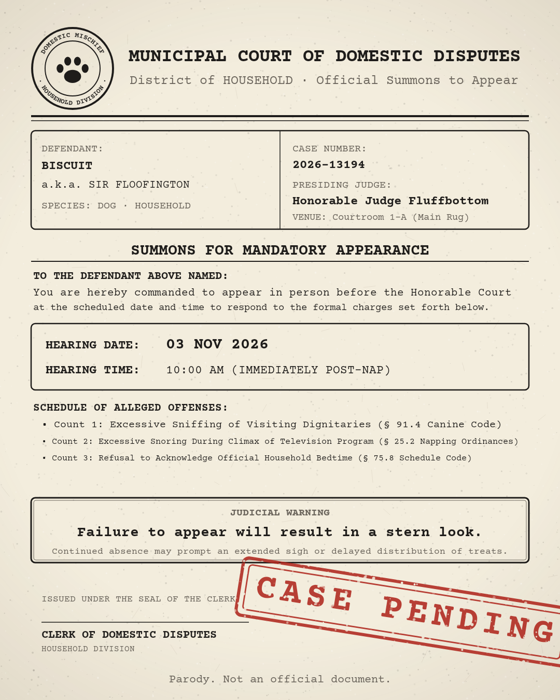
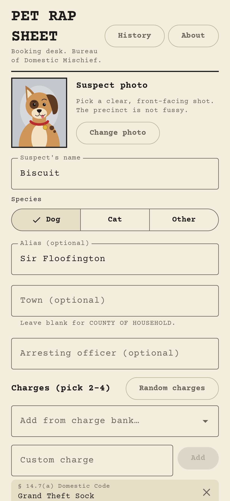
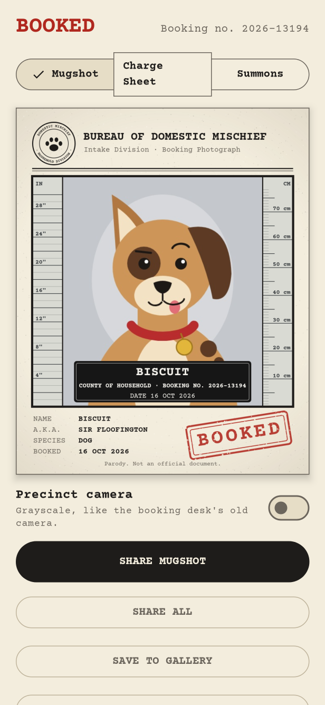
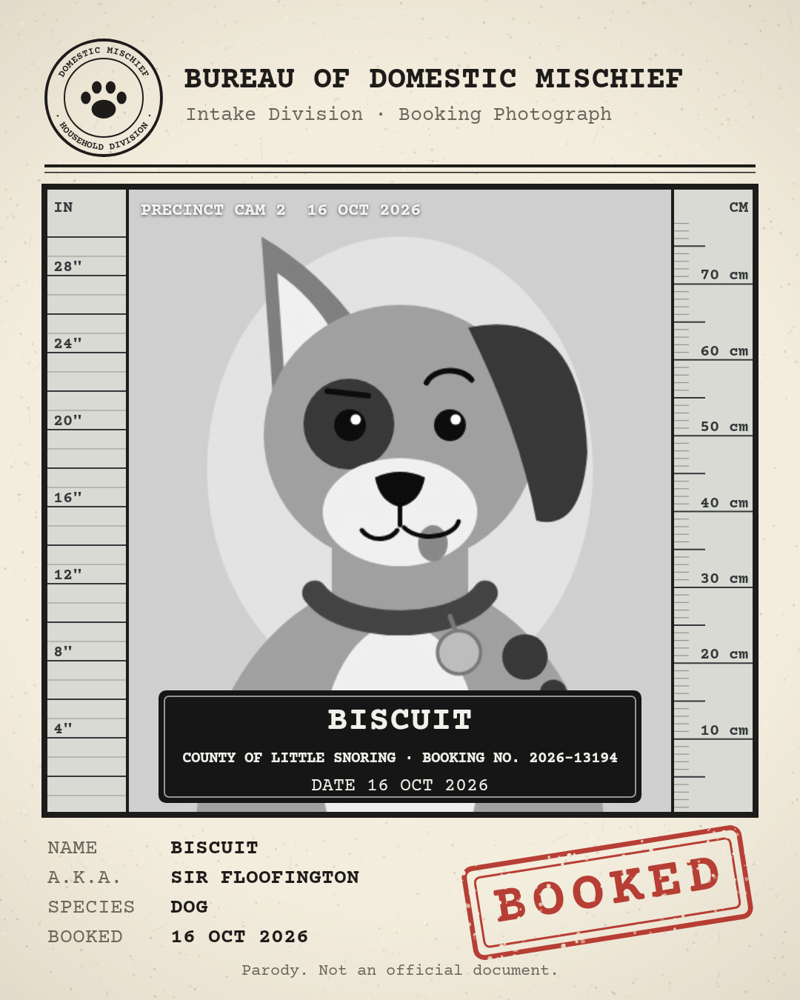

# Pet Rap Sheet

Pet Rap Sheet is a native Android delight toy: pick a pet photo, enter the suspect's name, species, optional alias, arresting officer, and jurisdiction, and generate a deadpan police booking pack:
- **Mugshot** placard document with front-facing suspect photo, suspect statistics, and booking stamp (with optional vintage precinct camera post-processing).
- **Charge Sheet** with official typography, precinct seal, and humorous domestic pet violations selected from a curated bank of charges.
- **Court Summons** mandating appearance before the Domestic Disciplinary Tribunal.

Everything is generated on-device. No accounts, no backend, no analytics, no ads, no cloud sync, and zero internet permissions.

<p align="center">
  
  
  
</p>

<p align="center">
  
  
  
</p>

---

## Architecture & Features

- **Jetpack Compose Single-Activity Architecture**: Built with Kotlin and Compose, targeting Android SDK 37 (minSdk 26).
- **Booking History**:
  - Saved bookings are stored in app-private internal storage (`context.filesDir/bookings/<id>/`).
  - Stores form metadata and random seed in `booking.json`, downsampled photo as `photo.png`, and a fast-loading thumbnail as `thumb.png`.
  - Generates identical documents upon reopening (seed-stable document generation).
  - Keeps the 20 most recent bookings, with full re-sharing and deletion capabilities (deleting purges associated images from disk).
- **About Screen**:
  - Highlights core privacy guarantees ("Nothing leaves your phone.").
  - Parody disclaimer (fictitious agencies, seals, and statutes).
  - Open-source font attribution and SIL Open Font License (OFL 1.1) notices for bundled Courier Prime.
- **Adaptive Launcher Icon**:
  - Vector drawable featuring a paw print on a police booking placard (`ic_launcher_foreground.xml` and `ic_launcher_background.xml`).
  - Monochrome layer (`ic_launcher_monochrome.xml`) supporting Android 13+ dynamic themed icons.
- **Security & Privacy**:
  - Merged manifest requests zero internet, camera, or storage permissions.
  - Image picking uses the system photo picker (`ActivityResultContracts.PickVisualMedia`).
  - Sharing uses Android `FileProvider` with temporary grant-read permissions.

---

## Development & Verification

Toolchain requirements:
- JDK 21, from `JAVA_HOME` (default `~/.local/jdk-21`)
- Android SDK, from `ANDROID_HOME` (default `~/.local/android-sdk`)

Environment configuration is provided in `scripts/env.sh`.

### Running Tests and Lint

Run the SDLC check script:
```bash
bash scripts/check.sh
```

This executes:
1. `testDebugUnitTest`: Robolectric unit tests and flow tests.
2. `verifyRoborazziDebug`: Pixel-perfect screenshot verification against committed reference PNGs.
3. `lintDebug`: Android lint with zero warnings or errors allowed.
4. `assembleDebug`: Debug APK compilation.

### Screenshot References

Roborazzi reference screenshots live in `app/src/test/screenshots/`. To update or re-record screenshots:
```bash
bash scripts/record-screenshots.sh
```

---

## Release Builds & Signing

Release builds use R8 minification and resource shrinking configured in `app/build.gradle.kts` and `app/proguard-rules.pro`.

### Unsigned Fallback

When signing credentials are not present, running `./gradlew assembleRelease` automatically falls back to producing an unsigned release APK (`app/build/outputs/apk/release/app-release-unsigned.apk`). This ensures continuous integration and `scripts/check.sh` run cleanly without secrets.

### Generating a Keystore

Generate a release keystore using Java's `keytool`:

```bash
mkdir -p ~/.config/pet-rap-sheet
keytool -genkeypair -v \
  -keystore ~/.config/pet-rap-sheet/release.keystore \
  -alias pet-rap-sheet \
  -keyalg RSA \
  -keysize 2048 \
  -validity 10000 \
  -storepass <YOUR_STORE_PASSWORD> \
  -keypass <YOUR_KEY_PASSWORD> \
  -dname "CN=Pet Rap Sheet, O=pet-rap-sheet"
```

*Note: The certificate subject must use only `CN=Pet Rap Sheet, O=pet-rap-sheet`.*

### Configuring Signing

Create a properties file at `~/.config/pet-rap-sheet/signing.properties`:

```properties
storeFile=/home/youruser/.config/pet-rap-sheet/release.keystore
storePassword=<YOUR_STORE_PASSWORD>
keyAlias=pet-rap-sheet
keyPassword=<YOUR_KEY_PASSWORD>
```

Alternatively, configure the signing parameters via environment variables:
- `RELEASE_STORE_FILE` (or `KEYSTORE_PATH`)
- `RELEASE_STORE_PASSWORD` (or `KEYSTORE_PASSWORD`)
- `RELEASE_KEY_ALIAS` (or `KEY_ALIAS`)
- `RELEASE_KEY_PASSWORD` (or `KEY_PASSWORD`)

### Building and Verifying the Signed APK

Build the release APK:
```bash
source scripts/env.sh
./gradlew assembleRelease
```

Verify signature using `apksigner`:
```bash
$ANDROID_HOME/build-tools/37.0.0/apksigner verify --verbose --print-certs app/build/outputs/apk/release/app-release.apk
```

---

## License

- App code and the original test artwork (the cartoon suspect in `app/src/test/`, drawn in code) are licensed under the [Apache License 2.0](LICENSE). Copyright 2026 pet-rap-sheet contributors.
- The bundled Courier Prime font is licensed under the SIL Open Font License 1.1 (`app/src/main/assets/fonts/CourierPrime-OFL.txt`).
- The Gradle wrapper (`gradlew`, `gradlew.bat`, `gradle/wrapper/`) is licensed under the Apache License 2.0 by Gradle.
